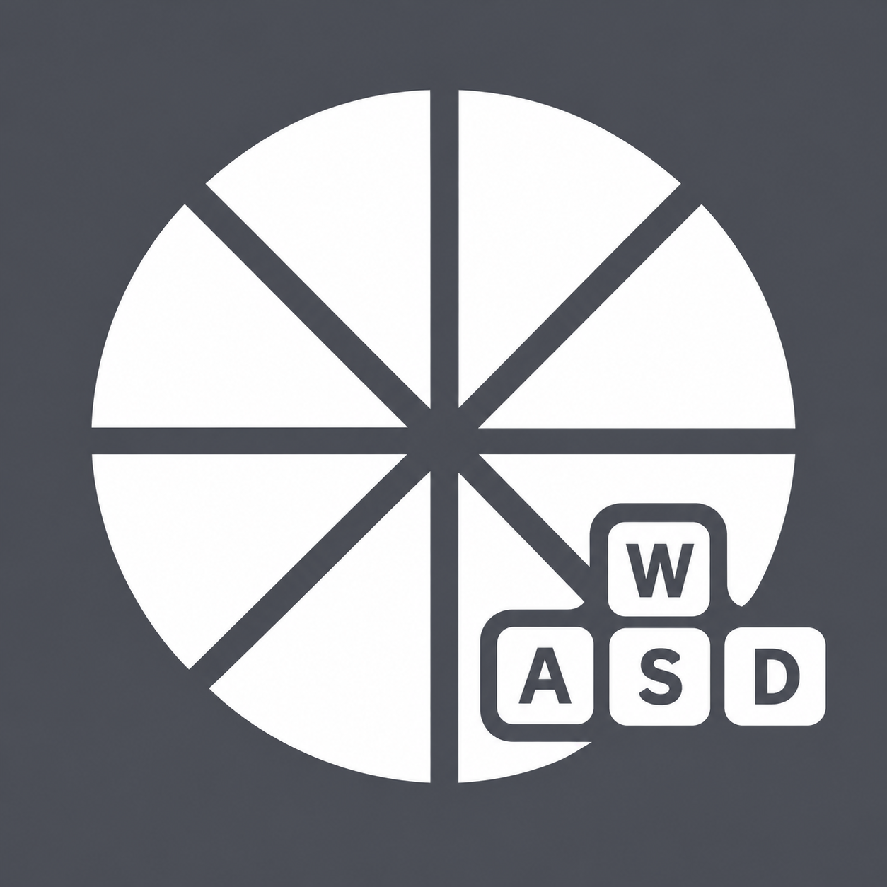
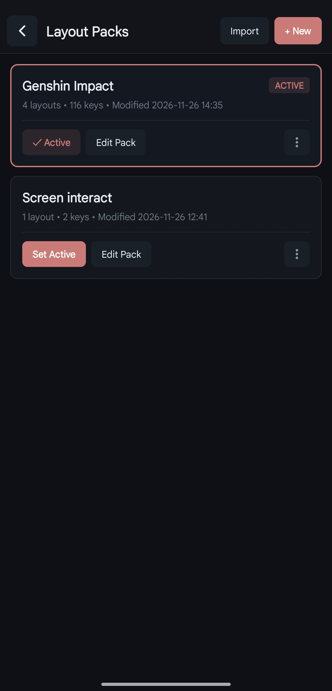
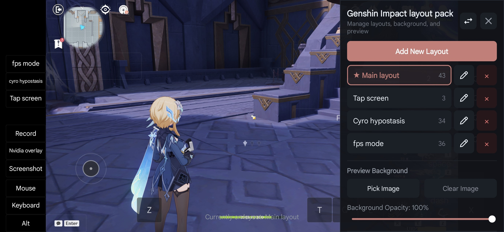
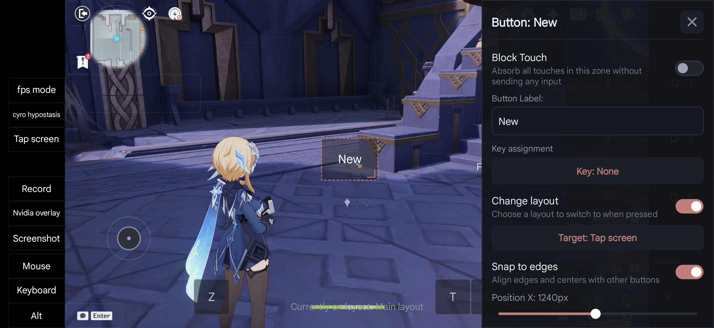
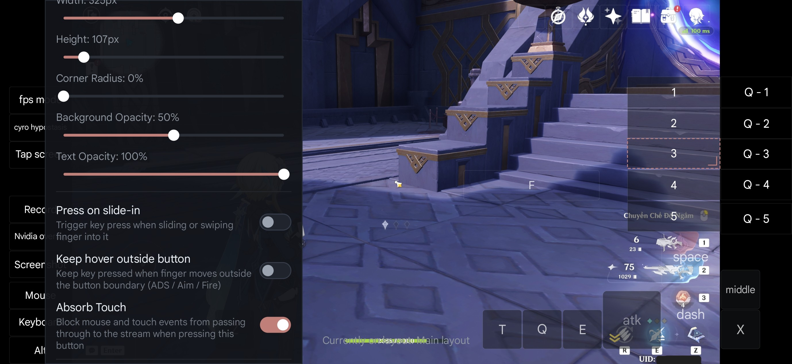
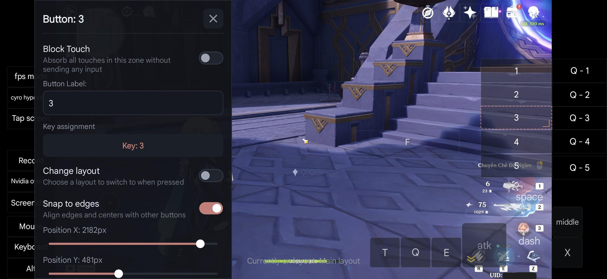
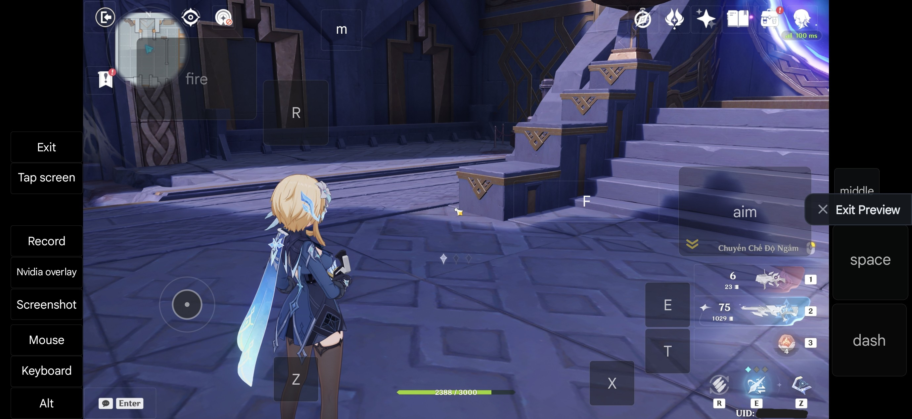

#  Moonlight Android — Keyboard Controller Edition

[](https://github.com/natelyt12/moonlight-android-keyboard-controller/releases/latest)

This repository is a customized fork of [Moonlight for Android](https://github.com/moonlight-stream/moonlight-android) (originally created by [Cameron Gutman](https://github.com/cgutman) and the Moonlight team). It replaces the traditional gamepad controller system with a powerful, fully customizable **PojavLauncher-style on-screen virtual keyboard and mouse layer**, tailored specifically for PC gaming (MMOs, FPS, RPGs, RTS) and remote desktop productivity directly on a touchscreen.

> [!TIP]
> **Side-by-side installation**: This app uses its own application ID, so it can be **installed and run alongside the original Moonlight app** on the same Android device without conflicts or overwriting. Every core Moonlight connection and streaming feature remains **100% intact** — only the gamepad controller system is removed and replaced by the virtual keyboard and mouse mapping system.

---

## 📱 Screenshots

|                       Layout Packs Manager                       |                       Layout Editor Sidebar                        |
| :--------------------------------------------------------------: | :----------------------------------------------------------------: |
|    |         |

|                       Button Key & Layout Switch                       |                 Button Size, Style & Touch Behaviors                 |
| :--------------------------------------------------------------------: | :------------------------------------------------------------------: |
|  |  |

|                  Adaptive Left/Right Button Inspector                  |                             Preview Mode                             |
| :--------------------------------------------------------------------: | :------------------------------------------------------------------: |
|  |                  |

> **Note:** The application does not come with any pre-bundled game layouts shown in the screenshots.

---

## ✨ What's New & Features in v2

- **Layout Packs & Sub-Layouts** ([Read the full guide](docs/LAYOUT_PACKS.md)):
  - Organize multiple **Sub-layouts** (e.g., *Combat*, *Inventory*, *Driving*, *Menu*) inside a single **Layout Pack** per game.
  - Set an **Active Layout** as the default on stream launch and bind **Change layout** on any button (even with `Key: None`) to switch layers on the fly.
  - Choose **Mouse Input Mode** (**Touchpad** or **Direct** Windows multi-touch) independently per sub-layout.
  - **Import / Export** full v2 packs via JSON file or clipboard, with backward compatibility for v1 JSON layouts.
- **Minimalist Dark Layout Editor**:
  - **Smart Edge & Center Alignment Guides** with `1px` slider precision.
  - **Lock 1:1 (Square)** sizing and **Corner Radius (0–100%)** control.
  - **0–4 Key Combo Picker** alongside Mouse and Action bindings.
  - **Temporary Menu Side Swap (`⇄`)** and an adaptive button inspector.
  - **Stream-Accurate Preview Mode** supporting multi-touch, sub-layout switching, and live PC Keyboard / Mouse overlays.
- **Isolated Multi-Touch & Redesigned D-Pad**:
  - Independent per-finger pointer tracking across D-Pad, `Slide`, `Keep hover outside button`, and `StreamView` pass-through.
  - Redesigned D-Pad with a clean directional arc indicator.
- **Compact Zero-Gap PC Keyboard & Mouse Overlays**:
  - Edge-to-edge zero-gap, square-cornered key tiles for maximum tap area in a compact footprint, highlighted with your device's dynamic accent color.
  - Adjustable mouse sensitivity and two-finger scroll speed.

> [!NOTE]
> **Differences from upstream**: To streamline touch keyboard and mouse gameplay, legacy USB gamepad drivers and the default on-screen gamepad controls have been removed in this fork.

---

## 📥 Download & Install

1. Download the latest APK from the [**Releases**](https://github.com/natelyt12/moonlight-android-keyboard-controller/releases/latest) page.
2. Enable _Install unknown apps_ for your browser or file manager, then install the APK. The app shows up as **Moonlight KB** (package `com.natelyt12.moonlightkb`), so it does not replace the official Moonlight app.
3. Start Moonlight, pair with your PC running [Sunshine](https://github.com/LizardByte/Sunshine) or NVIDIA GameStream, and stream any app or game.

### Which APK should I pick?

| Build     | Use it when                                                                                                        |
| :-------- | :----------------------------------------------------------------------------------------------------------------- |
| `nonRoot` | Default choice for every device.                                                                                   |
| `root`    | Only for rooted devices running Android 7.1 (API 25) or older, where root is needed to capture system mouse input. |

---

## 🛠️ Building from Source

### Requirements

- [Android Studio](https://developer.android.com/studio) (or the Android command-line SDK) with **Android SDK Platform 37**, **Build-Tools 36.0.0**, and **NDK 29.0.14206865**
- JDK 17 or newer

### Setup

```bash
# Clone with the native streaming submodule
git clone --recursive https://github.com/natelyt12/moonlight-android-keyboard-controller.git
cd moonlight-android-keyboard-controller
```

- In the project root, create a `local.properties` file and point `sdk.dir` at your Android SDK (Android Studio does this automatically). The NDK is resolved from the `ndk` directory of that SDK (see `ndkVersion` in [app/build.gradle](app/build.gradle)).
- Build the debug APK:

```bash
./gradlew assembleNonRootDebug
```

The APK is written to `app/build/outputs/apk/nonRoot/debug/`.

### Release builds

Release builds are minified with R8 and must be signed with your own keystore. Create one with:

```bash
keytool -genkeypair -v -keystore release.keystore -alias moonlight -keyalg RSA -keysize 4096 -validity 10000
```

Then add these properties to `~/.gradle/gradle.properties` (environment variables with the same names also work):

```properties
MOONLIGHT_STORE_FILE=/absolute/path/to/release.keystore
MOONLIGHT_STORE_PASSWORD=your-store-password
MOONLIGHT_KEY_ALIAS=moonlight
MOONLIGHT_KEY_PASSWORD=your-key-password
```

And build:

```bash
./gradlew assembleNonRootRelease
```

The signed APK is written to `app/build/outputs/apk/nonRoot/release/`.

### Automated releases (GitHub Actions)

[`.github/workflows/release.yml`](.github/workflows/release.yml) builds a signed `nonRoot` APK and attaches it to a GitHub Release whenever a `v*` tag is pushed. Configure these repository secrets first:

| Secret | Value |
| :--- | :--- |
| `KEYSTORE_BASE64` | Base64 of your keystore file, e.g. `base64 -w0 release.keystore` (PowerShell: `[Convert]::ToBase64String([IO.File]::ReadAllBytes("release.keystore"))`) |
| `KEYSTORE_PASSWORD` | Keystore password |
| `KEY_ALIAS` | Key alias inside the keystore |
| `KEY_PASSWORD` | Key password |

Then publish a build:

```bash
git tag v2.0
git push origin v2.0
```

The workflow uploads `MoonlightKB-<version>-nonRoot.apk` plus `SHA256SUMS.txt` and verifies the APK signature before publishing.

---

## About Moonlight

[Moonlight for Android](https://moonlight-stream.org) is an open source client for NVIDIA GameStream and [Sunshine](https://github.com/LizardByte/Sunshine).

Moonlight for Android lets you stream your full collection of games from your PC to your Android device, whether in your own home or over the internet.

Moonlight also has a [PC client](https://github.com/moonlight-stream/moonlight-qt) and an [iOS/tvOS client](https://github.com/moonlight-stream/moonlight-ios).

You can follow development on the official [Discord server](https://moonlight-stream.org/discord) and help translate official Moonlight into your language on [Weblate](https://hosted.weblate.org/projects/moonlight/moonlight-android/).

## Credits & Upstream Authors

All core streaming protocol and engine code are the work of the original **Moonlight GameStream** project:

- [Cameron Gutman](https://github.com/cgutman)
- [Diego Waxemberg](https://github.com/dwaxemberg)
- [Aaron Neyer](https://github.com/Aaronneyer)
- [Andrew Hennessy](https://github.com/yetanothername)

Moonlight was originally created by students at [Case Western Reserve University](http://case.edu) and started as a project at [MHacks](http://mhacks.org).

This fork is maintained at [natelyt12/moonlight-android-keyboard-controller](https://github.com/natelyt12/moonlight-android-keyboard-controller).
